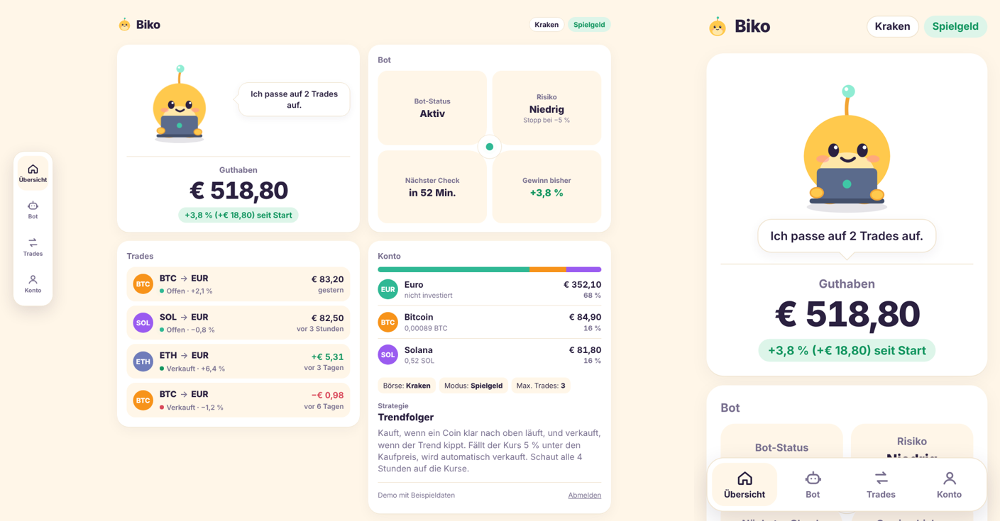

# Biko Bot: Freqtrade auf Kraken (Spot, Trendfolge 4h)

Eigener Krypto-Trading-Bot auf Basis von [Freqtrade](https://www.freqtrade.io). Lernprojekt mit 200–500 € Kapital, nur Spot, kein Hebel. Ziel ist nicht "Gewinn > 0", sondern **besser als BTC halten**, nach Gebühren und Steuer.
Geprüft gegen **Freqtrade 2026.10** (aktuelle stable, Python ≥ 3.12).

> **Nur mal testen, ohne PC?** Siehe [ANLEITUNG-TESTEN.md](ANLEITUNG-TESTEN.md): per Telegram zuschauen oder mit einer Zeile auf einem eigenen Server installieren, immer im Testmodus mit Spielgeld.

> **Neu: Biko Helfer.** Ein KI-Assistent fürs Handy (Deutsch und Chinesisch) liegt in [`assistent/`](assistent/README.md). Er ist unabhängig vom Trading-Bot.

## Inhalt

```
docker-compose.yml                    Freqtrade-Container (Image: freqtradeorg/freqtrade:stable)
.env.example                          Vorlage für Secrets -> nach .env kopieren
.gitignore / .cursorignore            .env, DB, Logs, Daten werden ignoriert
user_data/config.json                 Kraken Spot, BTC/EUR ETH/EUR SOL/EUR, dry_run: true
user_data/config.binance.json         dasselbe für Binance Spot
user_data/strategies/EmaTrendStrategy.py
docker-compose.testmodus.yml          erzwingt Dry-Run und leere Keys (für Tester)
docker-compose.live.yml               Echtgeld-Modus mit eigener Datenbank (nur über install.sh + BIKO_MODUS=live)
install.sh                            Ein-Zeilen-Installation auf Ubuntu/Debian-Server, Standard Testmodus
scripts/                              waechter.py (Alarm + Backup), notaus.sh, steuer_export.py, server-haerten.sh, backtest.sh
TODO.md                               Weg zum Echtgeld: was fertig ist, was du noch machen musst, feste Regeln
ANLEITUNG-TESTEN.md                   Anleitung für Tester ohne PC (Telegram/Handy)
```

## Was die Strategien machen

Es gibt drei Strategien, alle in `user_data/strategies/`. Sie teilen sich den Unterbau `BikoBase` (`biko_base.py`):
Positionsgröße, Stop-Loss an der Börse, Protections und Kill-Switch sind bei allen gleich. Nur Entry und Exit unterscheiden sich.
Welche läuft, steht in der Config (`"strategy"`) und lässt sich in der Biko-App wechseln.

| Strategie (Name in der App) | Entry | Exit | Stand |
|---|---|---|---|
| `EmaTrendStrategy` (Trendfolger) | EMA20 > EMA50 **und** Close > EMA200 | EMA20 < EMA50 | getestet (4h, BTC/ETH/SOL) |
| `BreakoutStrategy` (Ausbruch) | Close über dem Hoch der letzten 20 Kerzen (ohne die aktuelle) **und** Close > EMA200 | Close unter dem Tief der letzten 10 Kerzen | neu, noch kein Backtest |
| `DipBuyStrategy` (Rücksetzer) | Close > EMA200 **und** RSI(14) < 35 | RSI(14) > 65 oder +8 % (`minimal_roi`) | neu, noch kein Backtest |

Gemeinsam (BikoBase):

| Teil | Umsetzung |
|---|---|
| Kerzen | nur abgeschlossene Kerzen, Takt 4h (in der App 15m/1h/4h) |
| Stop-Loss | -5 %, als Stop-Order **an der Börse** (`stoploss_on_exchange`, Kraken und Binance unterstützen das im Spot) |
| Positionsgröße | `custom_stake_amount`: Konto × 1 % ÷ (5 % Stop + 1 % Kostenpuffer). Bei 500 € ≈ 83 € pro Trade, Verlust beim Stop ≈ 5 € |
| Protections | CooldownPeriod (8h), StoplossGuard (2 Stops in 2 Tagen → 1 Tag Pause), MaxDrawdown im `equity`-Modus (−3 % in 24h → 24h Pause) |
| Kill-Switch | Ab −15 % Konto-Drawdown (geschlossene Trades) blockiert `confirm_trade_entry` alle neuen Entries, dauerhaft bis du es manuell freigibst |

Hinweise:
- **Protections stehen in der Strategie**, nicht in `config.json`. Das ist seit 2024.10 so, Config-Protections sind veraltet.
- **Kein Edge-Modul** (gibt es seit 2025.6 nicht mehr), kein Hyperopt-Parameter, kein FreqAI.
- Bei 3 offenen Trades sind ca. 50 % des Kontos investiert, der Rest bleibt in EUR.
- Der Kill-Switch zählt nur realisierte Verluste. Offene Verluste sind durch den Stop auf ca. 1 % pro Trade begrenzt.
- Manueller Notaus: Telegram `/stopentry` (keine neuen Trades), `/stop` (Bot stoppen), `/forceexit all`.

## Börse wählen: Kraken oder Binance

Die Strategien sind börsenunabhängig (CCXT). Welche Config läuft, steuert `BOT_CONFIG` in der `.env`.
`install.sh` fragt beim Einrichten "1 = Kraken, 2 = Binance" und trägt das ein (nochmal ausführen = wechseln, oder ohne Frage mit `BIKO_BOERSE=binance`).

| | Kraken (`config.json`, Standard) | Binance (`config.binance.json`) |
|---|---|---|
| `.env` | `BOT_CONFIG=config.json` | `BOT_CONFIG=config.binance.json` |
| Paare | BTC/EUR, ETH/EUR, SOL/EUR | BTC/EUR, ETH/EUR, SOL/EUR |
| Gebühren (unterste Stufe) | laut meinem Stand ca. 0,25 % Maker / 0,40 % Taker, bitte prüfen | 0,1 % pro Seite, `--fee 0.001` passt |
| Stop an der Börse | Stop-Market | nur Stop-Limit (Limit 1 % unter dem Stop, `stoploss_on_exchange_limit_ratio: 0.99`). Bei einem schnellen Crash kann er ungefüllt bleiben |
| Historische Daten | API liefert nur 720 Kerzen, siehe unten | `download-data` lädt die volle Historie direkt |
| MiCA / Österreich | lizenziert | **keine MiCA-Lizenz seit 1.7.2026**, Zugang läuft über die Einheit in Abu Dhabi, ESMA prüft das |

**Empfehlung:** Binance ist für Backtests bequem (schnelle Daten, 0,1 % Gebühr). Für echtes Geld würde ich wegen der unklaren
MiCA-Lage auf eine lizenzierte Börse gehen und vor dem Live-Gang den aktuellen Stand prüfen. Ein Wechsel ist nur eine Zeile in der `.env`
plus ein neuer API-Key.

Bei den Befehlen unten `config.json` durch `config.binance.json` ersetzen, wenn du mit Binance arbeitest.
USDC statt EUR geht auch: `stake_currency` auf `USDC` und die Paare auf `BTC/USDC` usw. ändern. Für die Steuer ist EUR einfacher,
weil jeder Exit direkt in Euro realisiert wird.

## Einrichten

```bash
cp .env.example .env
# .env ausfüllen: mindestens API_SERVER__PASSWORD, JWT_SECRET_KEY, WS_TOKEN
# Zufallswert: python3 -c "import secrets; print(secrets.token_hex(32))"
docker compose pull
docker compose up -d          # startet im Dry-Run (echte Kurse, 500 € Spielgeld)
docker compose logs -f
```

FreqUI: http://127.0.0.1:8080 (Port ist nur lokal gebunden; auf dem VPS per `ssh -L 8080:127.0.0.1:8080 user@vps`).

Telegram: Token von @BotFather, Chat-ID z. B. über @userinfobot, dann in `.env` `FREQTRADE__TELEGRAM__ENABLED=true` setzen.

**Kraken API-Key** (erst für Live): Query Funds, Query Open/Closed Orders & Trades, Create & Modify Orders, Cancel/Close Orders. **Kein Withdraw.** IP-Whitelist auf die feste VPS-IP.

## Biko-App: die einfache Ansicht



Neben FreqUI (Profi-Ansicht, Port 8080) startet `docker compose up -d` auch die **Biko-App** auf Port 8081.
Sie hat fünf Ansichten, erreichbar über die Icon-Leiste (unten am Handy, links am großen Bildschirm):
**Übersicht** (Biko, Guthaben, Kurzstatus), **Bot** (Status-Kacheln, Pause/Weiter, Strategie), **Trades** (offen und zuletzt verkauft),
**Konto** (Coins, Börse, Modus) und **Einstellen**. In allen Ansichten außer der Übersicht sitzt ein kleiner Biko oben und sagt, was los ist.
Bewegung ist bewusst knapp: Eingänge mit Ease-out, Ausgänge kürzer, Knöpfe werden beim Drücken leicht kleiner, Listen kommen leicht versetzt,
nichts federt. Mit "Bewegung reduzieren" im System bleibt nur Ein-/Ausblenden. Biko zeigt die Stimmung des Bots:

| Biko … | wenn |
|---|---|
| tippt am Laptop | mindestens ein Trade offen ist |
| schläft | nichts offen ist und der Bot auf ein Signal wartet |
| jubelt / ist traurig | in den letzten 20 Minuten ein Trade mit Gewinn / Verlust geschlossen wurde |
| hält ein Pause-Schild | der Bot gestoppt ist oder keine neuen Trades kauft (`/stopentry`) |
| schaut verwirrt | die App den Bot nicht erreicht |

- **Am Handy (empfohlen): privat über Tailscale.** `install.sh` fragt "Biko-App am Handy über Tailscale einrichten?". Mit `j` installiert es
  Tailscale auf dem Server und gibt die App per `tailscale serve` frei: HTTPS-Adresse wie `https://biko.<dein-netz>.ts.net`, nur für deine eigenen
  Tailscale-Geräte sichtbar, nicht für das Internet. Anleitung fürs Handy: [ANLEITUNG-TESTEN.md](ANLEITUNG-TESTEN.md#biko-app-am-handy-tailscale).
  Von Hand: `sudo tailscale up` und `sudo tailscale serve --bg 8081`.
- Ohne Tailscale: http://127.0.0.1:8081, auf dem VPS per `ssh -L 8081:127.0.0.1:8081 user@vps`. Anmelden mit denselben Zugangsdaten wie FreqUI
  (`FREQTRADE__API_SERVER__USERNAME`/`PASSWORD` aus der `.env`, bei `install.sh` in `ZUGANGSDATEN.txt`).
- Eingreifen: In der Bot-Kachel gibt es **"Pause: nichts Neues kaufen"** bzw. **"Weiter handeln"** (Freqtrade `/stopentry` und `/start`),
  bei jedem offenen Trade **"Verkaufen"** (sofort zum Marktpreis, `/forceexit`). Jede Aktion fragt vorher nach.
  Von Hand kaufen, den Bot ganz stoppen oder Trades löschen geht über die App absichtlich nicht: nginx lässt außer Lesen (GET), Anmelden
  und diesen drei Aktionen nichts zum Bot durch (403). Die App lädt nichts von fremden Servern und hat kein Tracking.
- Einstellungen ("Einstellen" in der Leiste): **Strategie** (Trendfolger, Ausbruch, Rücksetzer, siehe oben), **Coins** (BTC, ETH, SOL, XRP, ADA, LINK, DOT, AVAX, LTC, DOGE),
  **Takt** (15 Min, 1 Std, 4 Std), **Risiko pro Trade** (0,5 bis 3 %) und **gleichzeitige Trades** (1 bis 6). Speichern schreibt `user_data/biko-settings.json`
  (zweite `--config`, nicht im Repo) und lädt den Bot neu (`/reload_config`). Das macht der kleine Dienst `biko-settings`
  (`ui/settings/server.py`, nur Python-Standardbibliothek, kein offener Port). Er prüft jede Anfrage mit dem Login der App und nimmt nur erlaubte Werte an.
  Stop-Loss (−5 %), Tageslimit (−3 %) und Kill-Switch (−15 %) sind dort absichtlich nicht änderbar. Die Protections rechnen in Stunden und passen sich dem Takt an.
  Ein Strategie-Wechsel gilt sofort auch für offene Trades: sie werden ab dann nach den Exit-Regeln der neuen Strategie verkauft, der Stop-Loss bleibt.
  Damit das geht, steht die Strategie in der Config (`"strategy"`) und **nicht** als `--strategy` im `docker-compose.yml` (das würde die Config überstimmen).
  **Achtung:** Getestet ist nur der Trendfolger mit 4 Std und BTC/ETH/SOL. Andere Strategien oder Einstellungen vor Echtgeld erst im Testmodus und im Backtest prüfen.
- Ohne Bot ansehen: `ui/web` mit einem beliebigen Webserver ausliefern und `?demo` anhängen, z. B. `python3 -m http.server -d ui/web 8000` → http://127.0.0.1:8000/?demo. Antippen von Biko wechselt die Stimmung, `?demo=schlaeft` usw. springt direkt hin.
- "Zum Home-Bildschirm hinzufügen" geht, dann sieht Biko aus wie eine eigene App. Den Port bitte **nicht** direkt ins Internet freigeben.
- Jede Person betreibt ihre eigene Instanz mit eigenem Konto und eigenem API-Key. Die App ist kein Dienst für andere.
- **Mehrere Bots auf einem Server** (zum Testen mit Spielgeld, z. B. für Familie): `curl -fsSL …/install.sh | BIKO_NAME=cousin bash`.
  Jeder Bot bekommt einen eigenen Ordner (`/opt/<name>-bot`), eigene Ports (in der `.env`: `INSTANZ`, `API_PORT`, `APP_PORT`, `TS_PORT`),
  ein eigenes Login und ein eigenes Maskottchen (`MASKOTTCHEN` = `biko` (dicker Vogel) oder `yojji` (Katze), `MASKOTTCHEN_NAME`; landet über `ui/web/instanz.js` in der App).
  Beide Maskottchen atmen, schauen sich um, machen zwischendurch kleine Bewegungen (Hüpfer, Kopf neigen, Flattern, Federschopf, Ohr, Schwanz) und freuen sich, wenn man sie antippt.
  Am Handy über Tailscale mit eigenem HTTPS-Port (z. B. `:8443`). Anleitung: [ANLEITUNG-TESTEN.md](ANLEITUNG-TESTEN.md#weg-c-eigener-bot-auf-nikos-server-nur-spielgeld).

## Die drei wichtigsten Befehle

Alle Befehle laufen im Container. `docker compose run --rm freqtrade <befehl>` startet einen Wegwerf-Container
mit demselben `user_data`-Ordner. Die Config-Pfade sind Pfade **im** Container.

### 1. `download-data`: historische Kerzen laden

```bash
docker compose run --rm freqtrade download-data \
  --config /freqtrade/user_data/config.json \
  --timeframes 4h \
  --timerange 20200101-
```

- `--timeframes 4h` muss zum Strategie-Timeframe passen.
- `--timerange 20200101-` heißt "ab 1.1.2020 bis heute". Ab 2020, weil die EMA200 auf 4h rund 600 Kerzen (≈ 100 Tage) Vorlauf braucht, bevor dein Testzeitraum 2021 beginnt.
- Paare kommen aus der `pair_whitelist` der Config.
- Daten landen in `user_data/data/kraken/` (Feather-Format).

**Kraken-Besonderheit:** Kraken liefert über die API nur die letzten 720 Kerzen. Freqtrade lädt bei Kraken deshalb automatisch
**Einzeltrades** und baut daraus Kerzen. Für mehrere Jahre BTC/EUR dauert das sehr lange (Stunden bis Tage).
Schneller geht es mit Krakens offiziellem Trade-History-Download (CSV-Zip, wird etwa quartalsweise aktualisiert, im Kraken Support Center unter "Downloadable historical market data"):

```bash
# CSV-Dateien der Paare (z. B. XBTEUR.csv, ETHEUR.csv, SOLEUR.csv) nach
# user_data/data/kraken/trades_csv/ entpacken, dann:
docker compose run --rm freqtrade convert-trade-data \
  --config /freqtrade/user_data/config.json \
  --format-from kraken_csv --format-to feather

docker compose run --rm freqtrade trades-to-ohlcv \
  --config /freqtrade/user_data/config.json -t 4h

# Danach die Lücke bis heute per API auffüllen:
docker compose run --rm freqtrade download-data \
  --config /freqtrade/user_data/config.json -t 4h
```

### 2. `backtesting`: Strategie auf Historie simulieren

```bash
docker compose run --rm freqtrade backtesting \
  --config /freqtrade/user_data/config.json \
  --strategy EmaTrendStrategy \
  --timerange 20210101-20231231 \
  --fee 0.001 \
  --enable-protections \
  --breakdown month
```

- `--fee 0.001` = 0,1 % **pro Seite** (Kauf und Verkauf werden je einmal belastet).
  **Achtung:** Krakens Standardgebühren für kleine Volumen liegen laut meinem Stand deutlich höher
  (Kraken Pro, unterste Stufe ca. 0,25 % Maker / 0,40 % Taker). Bitte auf kraken.com/features/fee-schedule
  prüfen und zusätzlich mit dem echten Wert testen, z. B. `--fee 0.004`. Wenn die Strategie nur mit 0,1 % funktioniert, funktioniert sie nicht.
- `--enable-protections` ist **nötig**, sonst ignoriert der Backtest die Protections.
- `--breakdown month` zeigt Ergebnisse pro Monat, damit du siehst, ob der Gewinn aus einer einzigen Phase kommt.
- Benchmark: Vergleiche das Ergebnis mit der Zeile "Market change" (Buy & Hold der Paare) und mit reinem BTC halten.

**Out-of-Sample-Split** (nicht schummeln, den finalen Test nur einmal laufen lassen):

| Phase | `--timerange` | Zweck |
|---|---|---|
| Entwickeln | `20210101-20231231` | Bull 2021, Crash 2022, Erholung 2023 |
| Validieren | `20240101-20241231` | erst anschauen, wenn die Regeln fix sind |
| Finaler Test | `20250101-` | einmal, am Ende |

### 3. `lookahead-analysis`: prüft, ob die Strategie in die Zukunft schaut

```bash
docker compose run --rm freqtrade lookahead-analysis \
  --config /freqtrade/user_data/config.json \
  --strategy EmaTrendStrategy \
  --timerange 20220101-20231231
```

- Führt einen Backtest aus und wiederholt dann jedes Signal mit **abgeschnittenen** Daten.
  Ändert sich ein Signal oder Indikator, wenn die Zukunft fehlt, liegt Look-ahead-Bias vor.
- Ergebnis: Tabelle mit `has_bias` pro Strategie. Muss `False` sein.
- Braucht genug Trades (Standard: mindestens 10, über `--minimum-trade-amount` änderbar).
- Limit-Orders werden dafür automatisch durch Market-Orders ersetzt, das ist so gewollt.

**Dazu gehört `recursive-analysis`** (prüft, ob genug Vorlaufkerzen da sind, damit die EMA200 stabil ist):

```bash
docker compose run --rm freqtrade recursive-analysis \
  --config /freqtrade/user_data/config.json \
  --strategy EmaTrendStrategy \
  --timerange 20230101-20231231 \
  --startup-candle 200 400 600 1000
```

Die Abweichung der `ema_trend`-Werte sollte bei 600 Kerzen praktisch 0 % sein. Wenn nicht, `startup_candle_count` erhöhen.

## Vor dem Live-Gang

Die komplette Liste steht in **[TODO.md](TODO.md)**: was im Code schon für Echtgeld gebaut ist, was du noch machen musst
(Telegram, SSH-Schlüssel, Server härten, Backtests, 8 Wochen Testmodus, API-Key) und die festen Regeln, wann live gegangen
und wann wieder gestoppt wird.

Kurzfassung: Echtgeld geht **nur** über `BIKO_MODUS=live` in der `.env` plus `install.sh`. Das Skript prüft Keys und Telegram,
fragt beim ersten Mal nach und startet den Bot mit einer **eigenen Datenbank** (`tradesv3.live.sqlite`). Spielgeld- und
Echtgeld-Trades kommen nie in dieselbe Datenbank, der Bot verweigert sonst den Start. Der Dienst `biko-waechter` meldet per
Telegram, wenn der Bot hängt oder ein Trade ohne Stop an der Börse ist, und sichert die Datenbank täglich.
Notaus: `sudo /opt/biko-bot/scripts/notaus.sh`. Steuer: `python3 scripts/steuer_export.py <jahr>`.

## Hinweis

Keine Anlageberatung. Nur eigenes Geld, nicht für andere betreiben (in Österreich sonst ggf. lizenzpflichtige Portfolioverwaltung nach MiCAR).
